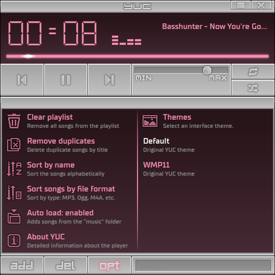

# YUC Music Player

A lightweight Winamp Classic-inspired desktop audio player built with Python and PyQt6.

# Installation Guide

## Requirements

- Ubuntu, Lubuntu, or another Debian-based Linux distribution.
- Python 3.
- An active internet connection for the initial installation.

## Installation

1. Download or clone the YUC Player repository:

   ```bash
   git clone https://github.com/nazaxii/yuc_player.git
   ```

2. Open the project directory:

   ```bash
   cd yuc_player
   ```

3. Make the installer executable:

   ```bash
   chmod +x install.sh
   ```

4. Run the installer:

   ```bash
   ./install.sh
   ```

The installer will automatically:
- Install the required system dependencies.
- Create a Python virtual environment.
- Install the required Python packages.
- Prepare the launcher script.

## Launching

After installation, start YUC Player using:

```bash
./run.sh
```

You can also launch `run.sh` by double-clicking it in your file manager. If prompted, select **Run** or **Execute**.

## Updating

To update YUC Player, navigate to its directory and pull the latest changes:

```bash
git pull
```

If new dependencies have been added, run the installer again:

```bash
./install.sh
```
## Preview



## Notes

- Do not delete the `venv` directory unless you want to reinstall the Python dependencies.
- Keep the `themes`, `icons`, and `font.ttf` files alongside `main.py`.
- The player stores its playlist in `playlist.json` inside the project directory.
